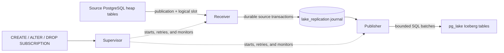

# pg_lake_replication

[](https://github.com/proddata/pg_lake_replication/actions/workflows/ci.yml)
[](LICENSE)

Logical replication from ordinary PostgreSQL tables into
[pg_lake](https://github.com/Snowflake-Labs/pg_lake) Iceberg tables.

`pg_lake_replication` runs beside an existing PostgreSQL 18 + pg_lake
installation. It takes an initial snapshot, consumes logical replication,
stages source transactions durably, and publishes bounded micro-batches into
Iceberg tables. A PostgreSQL extension provides familiar
`CREATE SUBSCRIPTION ... WITH (lake_target = 'iceberg')` lifecycle commands.

> [!WARNING]
> This project is approaching its first beta and is not production-ready yet.
> The release gates, remaining work, and evidence are tracked in
> [BETA-RELEASE.md](BETA-RELEASE.md). The supported beta target is pg_lake's
> local PostgreSQL catalog; REST catalogs are not supported.

## Why this exists

PostgreSQL's built-in logical-replication apply worker cannot write directly to
a pg_lake Iceberg foreign table. This project provides a separate replication
path designed for that boundary while retaining PostgreSQL-native setup and
control commands.

It currently supports:

- initial snapshot copy followed by continuous logical replication;
- `INSERT`, `UPDATE`, `DELETE`, primary-key changes, and `TRUNCATE`;
- transaction-aware, row- and byte-bounded Iceberg micro-batches;
- publication table discovery, column lists, and row filters;
- automatic creation of missing Iceberg destination tables;
- safe nullable-column additions and fail-closed incompatible schema changes;
- crash recovery, idempotent replay, and ambiguous-commit reconciliation;
- supervisor restart, retry, health state, and journal retention;
- source continuity checks and ordered failover endpoints; and
- PostgreSQL 18 packages for Linux amd64 and arm64.

## How it works



The destination PostgreSQL database contains the control schema and journal.
The four installed executables perform initial copy, receive WAL, publish
batches, and supervise the service. `lake_replication` intercepts only
subscriptions marked with `lake_target = 'iceberg'`; normal PostgreSQL
subscriptions continue through PostgreSQL unchanged.

## Compatibility

| Component | Beta target | Validated configuration |
|---|---|---|
| PostgreSQL | 18.x | 18.6 |
| pg_lake | 3.6, local PostgreSQL catalog | commit `8180647d4535fdb1ed223f92f301ba6094a8ec3e` |
| Operating system | Linux with Debian 12-compatible glibc | Debian 12 build images |
| Architecture | amd64, arm64 | native release archives for both |
| Object storage | S3-compatible storage supported by pg_lake | MinIO in the integration lab |

The pg_lake commit above is a validated point, not a claim that every adjacent
revision is compatible. See the complete
[compatibility contract](deploy/install/COMPATIBILITY.md).

## Quick start

The following walkthrough assumes a source database named `application` and a
pg_lake-enabled destination database named `analytics`. It is intended for a
disposable evaluation environment; review the [beta limitations](#beta-limitations)
before using real data.

### 1. Prepare the source

The source must have logical replication enabled and be reachable from the
destination host. Set appropriate capacity for the expected subscriptions and
restart the source after changing these server settings:

```conf
wal_level = logical
max_replication_slots = 10
max_wal_senders = 10
```

Then create a table and one publication:

```sql
-- Run in the source database: application
CREATE TABLE public.orders (
    id bigint PRIMARY KEY,
    customer text NOT NULL,
    total numeric(12, 2) NOT NULL,
    updated_at timestamptz NOT NULL DEFAULT now()
);

CREATE PUBLICATION orders_pub FOR TABLE public.orders;
```

Updates and deletes require a usable replica identity, normally a primary key.

### 2. Install beside PostgreSQL and pg_lake

The first signed prerelease is not published yet. Until it is, build the native
bundle from a clean checkout:

```sh
make install-bundle
tar -xzf dist/pg_lake_replication-0.1.0-beta.1.tar.gz -C /tmp
cd /tmp/pg_lake_replication-0.1.0-beta.1
sudo ./install.sh
```

The installer verifies the bundle, PostgreSQL major version, pg_lake and
`dblink` availability, and CPU architecture before copying anything. It
installs four executables under `/usr/local/bin` plus the two PostgreSQL
extensions. It does not change PostgreSQL configuration or database objects.

To build release-style archives for both supported architectures instead, run
`make install-bundles`; the results are written to `dist/release/`.

### 3. Configure the destination server

Append `lake_replication` to any existing
`shared_preload_libraries` value and choose the pg_lake destination database:

```conf
# postgresql.conf
shared_preload_libraries = 'pg_extension_base,lake_replication'
lake_replication.database_name = 'analytics'
lake_replication.log_directory = '/var/log/postgresql/pg_lake_replication'
lake_replication.credential_file = '/etc/pg_lake_replication/worker.env'
```

The exact existing preload list depends on the pg_lake installation; preserve
all of its entries when appending `lake_replication`.

Create the credential file as a regular, non-symlink file readable only by the
PostgreSQL operating-system user (`0600`):

```text
LAKE_SOURCE_USER=lake_source
LAKE_SOURCE_PASSWORD=replace-me
LAKE_SOURCE_TLS_MODE=verify-full
LAKE_SOURCE_TLS_ROOT_CERT=/etc/ssl/certs/source-ca.pem
LAKE_DESTINATION_USER=lake_worker
LAKE_DESTINATION_PASSWORD=replace-me-too
LAKE_DESTINATION_TLS_MODE=disable
```

Environment variables explicitly set for a manually launched worker override
the file. This instance-wide setting is the default for subscriptions that do
not select their own file. Launcher-managed workers receive only a file path;
credential values are not copied into worker-launch metadata or structured
logs.

Create the log directory with ownership and permissions suitable for the
PostgreSQL operating-system user, then restart PostgreSQL. In the destination
database, install the extensions and activate the SQL hook for future sessions:

```sql
-- Run in the pg_lake-enabled destination database: analytics
CREATE EXTENSION dblink;
CREATE EXTENSION lake_replication;

ALTER DATABASE analytics SET session_preload_libraries = 'lake_replication';
```

Reconnect after changing `session_preload_libraries`. Subscription management
requires superuser or membership in the extension-created admin role:

```sql
GRANT lake_replication_admin TO replication_operator;
```

### 4. Create an Iceberg subscription

Run this in `analytics`:

```sql
CREATE SUBSCRIPTION orders_to_lake
  CONNECTION 'host=127.0.0.1 port=5432 dbname=application user=postgres'
  PUBLICATION orders_pub
  WITH (lake_target = 'iceberg',
        lake_credential_file = '/etc/pg_lake_replication/orders.env');
```

The command discovers the publication, creates corresponding
`USING iceberg` tables in `public`, performs the initial copy, and starts the
supervisor. Use `lake_target_schema` to select another destination schema:

```sql
CREATE SUBSCRIPTION orders_to_lake
  CONNECTION 'host=127.0.0.1 port=5432 dbname=application user=postgres'
  PUBLICATION orders_pub
  WITH (lake_target = 'iceberg', lake_target_schema = 'warehouse');
```

Exactly one publication is supported per subscription in the current beta.
`lake_credential_file` must be an absolute path. To rotate its values or move
the subscription to another owner-only file, replace the file atomically and
reload just that subscription; PostgreSQL itself does not restart:

```sql
ALTER SUBSCRIPTION orders_to_lake
  SET (lake_credential_file = '/etc/pg_lake_replication/orders.env');
```

Setting the same path is intentional: it increments the subscription's launch
configuration generation and gracefully replaces its supervisor, which reads
the file again before reconnecting.

### 5. Verify replication

Inspect service state on the destination:

```sql
SELECT subscription_name,
       health_state,
       health_reason,
       subscription_state,
       service_state,
       heartbeat_age_seconds,
       source_lag_bytes,
       journal_lag_bytes,
       consecutive_failures,
       last_error
FROM lake_replication.subscription_status;
```

Then insert a row on the source and query its Iceberg counterpart on the
destination:

```sql
-- application
INSERT INTO public.orders (id, customer, total)
VALUES (1, 'Ada', 42.00);

-- analytics
SELECT * FROM public.orders WHERE id = 1;
```

## Operating subscriptions

The familiar lifecycle commands are routed to this project's control plane for
subscriptions created with `lake_target = 'iceberg'`:

```sql
ALTER SUBSCRIPTION orders_to_lake DISABLE;
ALTER SUBSCRIPTION orders_to_lake ENABLE;
DROP SUBSCRIPTION orders_to_lake;
```

Useful first checks are:

- `lake_replication.subscription_status` for classified health, lag, retries,
  failures, cycle counts, queue depth, checkpoints, and source continuity;
- `lake_replication.metrics` for long-form numeric samples consumable by a
  PostgreSQL metrics exporter;
- PostgreSQL's server log for launcher/background-worker events; and
- the configured `lake_replication.log_directory` for per-subscription
  worker output.

See the [operations guide](docs/operations.md) for metric names, suggested alert
thresholds, structured log fields, and the first-response checklist. Before
changing an installed version, follow the coordinated
[upgrade, backup, and rollback procedure](docs/upgrade-and-rollback.md).

## Beta limitations

- PostgreSQL 18 and pg_lake 3.6 with the local PostgreSQL catalog are the only
  current targets. PostgreSQL 16, 17, and 19 are not supported.
- REST-catalog destinations are intentionally unsupported because pg_lake's
  catalog update occurs after PostgreSQL commit and does not provide the
  durable reconciliation contract this project requires.
- Only one publication is accepted per subscription.
- Mapping version 1 supports common scalar types plus bounded Iceberg decimals,
  `varchar`, and `char`. Unconstrained or over-precision numerics, arrays,
  enums, domains, generated columns, and custom types remain fail-closed; see
  the [feature boundaries](docs/feature-gaps.md).
- Each subscription may select and reload its own owner-only credential file.
  The source password may still appear in the protected
  `lake_replication.pending_cleanup` table when it is embedded in
  `CREATE SUBSCRIPTION ... CONNECTION`, matching PostgreSQL's own
  subscription-conninfo tradeoff.
- Compatibility has been validated against one pg_lake revision. Extended
  compatibility, recovery-drill, observability failure-path, security, and
  release-candidate soak gates remain open.
- No signed GitHub prerelease has been published yet. Source checkouts and CI
  artifacts are development outputs until `v0.1.0-beta.1` is released.

For the complete current decision record, see
[BETA-RELEASE.md](BETA-RELEASE.md).

## Try the local demo

The repository includes a self-contained Compose demonstration with source and
destination databases, pg_lake, object storage, continuously running workers,
and a small SQL console:

```sh
make poc-build
make poc-up
```

Open <http://127.0.0.1:8080>. The initial build compiles pg_lake and can take a
while. This stack uses loopback-only trust authentication and no TLS; it is a
demo, not a deployment template. See the [demo walkthrough](deploy/poc/README.md).

Stop it while keeping its data with `make poc-stop`, or remove its containers
and volumes with `make poc-down`.

## Development

Requirements for repository checks are Docker with Compose, Rust 1.85, Python
3, and Make.

Upstream source is pinned as a Git submodule at `vendor/pg_lake`. Initialize
it once after cloning:

```sh
git submodule update --init vendor/pg_lake
```

`make lab-build` and `make poc-build` prepare a local Git bundle and build
from that source, without fetching the top-level pg_lake repository in Docker.
Upstream nested dependencies and other build prerequisites still download on
their first build. Standalone release bundles remain independent of the
submodule and install beside the customer's existing pg_lake installation.
See [upstream development and integration](docs/upstream-integration.md) for
revision overrides, direct Docker builds, and the worker integration assessment.

```sh
make check                 # formatting and offline/static checks
make install-bundle        # native installable archive
make install-bundle-test   # test the exact exported archive in the lab
```

The integration lab contains correctness, crash, schema, failover, TLS, SCRAM,
slot-loss, and maintenance probes. It builds a large development image and is
kept separate from the quick start. See the [feasibility report](docs/feasibility.md)
and [historical evidence](docs/) before running individual lab targets.

## Documentation

- [Beta release gates](BETA-RELEASE.md)
- [Compatibility contract](deploy/install/COMPATIBILITY.md)
- [Bundle and installer details](deploy/install/README.md)
- [Operations, metrics, logs, and alerts](docs/operations.md)
- [Local demo](deploy/poc/README.md)
- [Feasibility and correctness report](docs/feasibility.md)
- [Dependency and license inventory](docs/dependencies.md)
- [Beta feature boundaries](docs/feature-gaps.md)
- [Why native PostgreSQL apply cannot target Iceberg](docs/native-subscription-spike.md)

## License

This project is licensed under the [PostgreSQL License](LICENSE).
